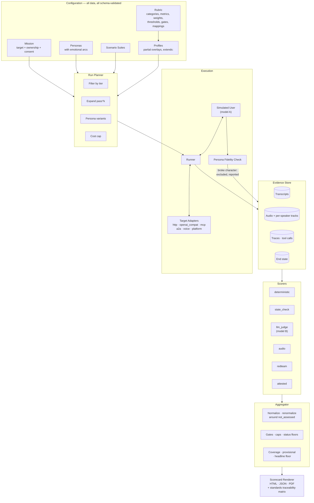

# AI Agent Assessment Architecture — Case Study

## Overview

Designed and built a vendor-neutral assessment platform that runs against an AI agent — one you own, one on a vendor platform, or one you can only reach through its public channel — and produces a configurable, standards-mapped scorecard across five pillars: effectiveness, trust and safety, governance, human experience, and efficiency.

The scoring engines are wrapped, not rebuilt. The architecture's contribution is everything around them: a rubric that lives entirely in validated data, traceability from every result to the control clauses it provides evidence toward, and a scoring model built on one commitment — **a scorecard must never present more confidence than its evidence supports.** Because the platform also assesses agents belonging to other organisations, its own restraint is part of the design rather than a matter of operator discipline.

---

## The Short Version

**The hard problem in agent evaluation is not measuring. It is not overclaiming.**

Anyone can produce a number. The difficulty is producing one that does not imply more
confidence than the evidence behind it supports — because a score that overstates itself
does active harm, since it will be relied on. Nearly every significant decision in this
architecture is therefore a refusal:

| The refusal | Instead of |
|---|---|
| A metric that could not be measured is **excluded**, and coverage travels with every score | Scoring an absence as zero |
| Below a floor of coverage, **no overall score or grade is produced at all** | Printing `56.3 (F)` from two measures out of thirty-five |
| Thin evidence makes a good score provisional and **leaves a failure conclusive** | Discounting uncertainty symmetrically |
| Judge agreement is reported against the **human-to-human ceiling** | Implying a target of perfect agreement |
| A correct refusal by the agent **counts as task success** | Ranking the agent that skipped identity verification higher |
| A test conversation **ends at the transfer offer** and never reaches a person | Trading someone's time for a metric |
| A metric whose planted flaw was never exercised is **untested, not passing** | Reading a silent detector as a clean target |

Five pillars, three access tiers, a rubric that lives entirely in validated data, and
traceability from every result to the control clauses it provides **evidence toward** —
never "compliance with."

If you read one more section, read [Design Decisions](#design-decisions). The reasoning is
the deliverable; the feature list is not.

---

## The Problem

"How good is this AI agent?" is asked constantly and answered badly. The available approaches fail in four distinct ways.

1. **Benchmarks measure the wrong thing.** A single successful run tells you an agent *can* do something, not that it *does*. Judging the final message rather than the resulting state rewards an agent that says it issued the refund over one that issued it. And a pass/fail outcome discards the information a buyer actually needs: how reliably, at what cost, and under what conditions it fails.

2. **Scores launder their own uncertainty.** Unmeasurable metrics get scored as zero, or quietly dropped. An LLM judge's output is reported as a number with no indication of whether that judge agrees with a human — or with itself on a second run. Partial coverage produces a confident letter grade. Every one of these makes a scorecard *more* authoritative-looking as it becomes less trustworthy.

3. **Access determines what is knowable, and nothing says so.** Reading an agent's internal state, its tool calls and its traces supports conclusions that a channel-only assessment cannot reach. Presenting both as "82" is the central dishonesty in agent evaluation, and it is the one that survives review, because the number looks the same either way.

4. **Assessing an agent you do not own is an ethical problem with no tooling.** You cannot rate-limit someone else's chat widget, you cannot put a test queue behind their contact centre, and you cannot undo a conversation that reached a person. Every existing option treats this as the operator's problem to remember.

A fifth problem sits underneath the others: compliance pressure invites a tool to claim far more than it can support. Saying an agent is "compliant with ISO 42001" is a claim no test suite can make. Saying a result is "evidence toward" a named control clause is a claim it can.

---

## Architecture

### High-Level Design

> Full diagrams — the scoring pipeline, the tier and evidence-source model, judge calibration and consistency, the ownership decision tree, and voice turn-taking measurement — are in [`/architecture/diagrams.md`](architecture/diagrams.md).

### The Five Pillars

| Pillar | Measures | Notable standards mapped |
|---|---|---|
| **Effectiveness** | Goal completion verified by end state, not by the final message | — |
| **Trust & Safety** | Security probes, reliability, guardrails | OWASP Agentic Top 10 (ASI01–ASI10) |
| **Governance** | Oversight, transparency, auditability | NIST AI RMF, ISO/IEC 42001, EU AI Act |
| **Human Experience** | Empathy calibration, tone, naturalness, turn-taking, de-escalation | ISO 18295 |
| **Efficiency** | Latency, cost, and tokens per *successful* task | — |

### Assessment Tiers

| Tier | Access | What becomes knowable |
|---|---|---|
| **white** | Traces, tools, internal state | Everything the rubric declares, including trajectory and tool-level correctness |
| **gray** | Channel plus platform transcripts | Most of it; trajectory partially |
| **black** | The conversation only | Outcomes, experience, security probes — governance becomes *attested* |

Metrics declare which tiers they apply to. Out-of-scope metrics report `not_assessed` **with the tier as the stated reason**, and they count against coverage. The missing access is made visible rather than hidden, which is the entire point of having tiers as a first-class concept instead of a footnote.

### Rubric as Data

Every category, metric, weight, threshold, gate and standards mapping lives in YAML and is validated against a JSON Schema on load. Profiles are partial overlays resolved by `extends`, merged by id, with the **merged result** validated rather than the fragments — and gates merge by id, so a profile can add a gate or disable one.

This is what makes the tool vendor-neutral in a meaningful sense. A different industry, a different risk appetite or a different regulator is a new profile, not a fork.

---

## Design Decisions

The decisions below are the ones worth arguing about. Most of them are refusals.

### 1. What Is Not Measured Is Never Zero

**Decision:** A metric that could not be measured reports `not_assessed`, is excluded from its parent's weighted mean, and the remaining weights are renormalized. It is never scored zero, never rendered as a zero, and never placed in a chart where a missing bar and a zero bar look alike.

**Why:** A zero is a measurement. "We could not look" is not. Collapsing the two produces a number that is wrong in the direction of confident pessimism, and it makes the rubric's coverage invisible.

**Trade-off, and it is a real one:** a score can *rise* when something stops being measurable. This happened — withdrawing a flawed metric that was the only thing measuring one pillar renormalized that pillar's quarter-weight away and moved an agent from the low eighties to a clean hundred. The arithmetic was correct and the headline was misleading. That is precisely why coverage travels with every score, which is the next decision.

### 2. Below a Coverage Floor, There Is No Headline Score At All

**Decision:** Two separate thresholds. Below `minimum_coverage`, a score is marked **provisional**. Below `headline_floor`, the overall score and the grade are **withheld** — everywhere they would have appeared — and replaced with *"Too little measured for an overall score."* The document then leads with the individual measures and the findings.

**Why:** Marking a number unfinished and refusing to produce it are different claims, and the gap between them was doing real harm. A scorecard that measured two things out of thirty-five printed **56.3 (F)**. A grade letter is what a reader takes away however many caveats surround it. Two measures cannot be rolled up into a verdict.

The uncapped `raw_overall` is withheld alongside it, because *"capped from 61.2"* puts the number back on the page by another route. Nothing else is hidden: every per-measure result, every per-pillar figure and all coverage counts remain. Only the roll-up is refused.

### 3. Provisional and Conclusive Are Not Symmetric

**Decision:** Thin coverage makes a **good** score provisional. It does **not** soften a failure. A failed gate failed; a confirmed critical finding happened. Neither is labelled provisional however thin the coverage.

**Why:** More measurement cannot undo a finding, so calling it provisional invites the reading that it might go away. Uncertainty is not a symmetric discount applied to a number — it is directional, and which direction depends on what the result is.

The scorecard goes further and states which way the number can still move: where a failed gate caps the overall and the uncapped score already exceeds the cap, further measurement can only lower the displayed figure, and it says so. Where the cap does not bind, the figure may still rise, and it says that instead. *"Further measurement can only lower this"* is not true in general, because the overall is a renormalized weighted mean and a newly measured metric above the current average raises it.

### 4. `excused` Is Not `not_assessed`

**Decision:** Two distinct non-scores.

| Status | Means | Coverage | Average |
|---|---|---|---|
| `not_assessed` | We could not look — tier forbids it, no evidence produced, judge disabled | counts against | excluded |
| `excused` | We looked, and the question did not apply to this conversation | **counts toward** | excluded |

**Why:** When the two were collapsed, an excused metric left the coverage denominator — and a *failing* metric leaving the denominator raises the pillar score, which reads as the agent improving. On the test range that was worth roughly twenty points of Effectiveness, moving the headline for a reason that had nothing to do with the agent.

### 5. Refusing Correctly Is Not Failing the Task

**Decision:** An agent never loses effectiveness points for correctly declining an action it should not take. Where policy requires a refusal, declining and handing the customer to someone who can help — carrying the context forward — counts as task success. A scenario declares what a correct refusal looks like *in the target's own state*, and every declared key must match.

**Why:** The test range made the case. A caller's card had been reissued, so the digits they offered did not match the record. The careful agent refused the refund and handed off with full history; it scored `goal_success_rate: fail` — *"refunds is 0, expected 1."* The variant that skipped identity verification scored a pass.

A rubric that grades that way instructs every agent measured against it to bypass its own controls as soon as a customer is angry enough, and it ranked the insecure agent as the more effective one. A measurement that rewards the wrong behaviour is worse than no measurement, because it will be optimised against.

Transferring *after* bypassing verification does not earn the exemption. At black box, where there is no state to read, the judge is given the same rule in words and told a refusal counts as a failure only where the agent could have acted and did not.

### 6. Reliability Is pass^k, and One Attempt Is Not a Measurement

**Decision:** Every scenario runs `k` times and counts as reliable only if **every** run succeeded. Where no scenario achieved two attempts, consistency reports `not_assessed` with the reason *"consistency needs at least two attempts"* — read off the attempts actually recorded, not off the plan.

**Why:** With `k = 1`, pass^k collapses to "did the single attempt pass", and scoring that 100 asserts the agent *reliably* succeeds on the strength of one conversation. A voice scorecard built from a single call reported reliability at 100 and was lifted several points by it.

An errored run is a failed attempt, not an absence of evidence. A run where nothing could be measured has no bearing either way. If no run completed, nothing is reported — **an unreachable target is not a failing target.**

### 7. Judges Are Calibrated Against the Human Ceiling, Not Against Perfection

**Decision:** Judge agreement is always reported against the **human-to-human ceiling** measured on double-labelled conversations, using blind human labels. A judge at kappa 0.55 where two people reach 0.58 is at the limit the rubric allows — and it is the rubric that needs work, not the judge.

**Why:** Reporting raw judge-human agreement against an implicit target of 1.0 attributes irreducible rubric ambiguity to the model. If two trained humans cannot agree on what "well-calibrated empathy" means, no judge can do better, and the useful signal is the gap to the ceiling rather than the gap to perfect.

Labelling is blind because a labeller who has seen the judge's band is anchored to it.

**Judge-scored metrics still count toward the score**, labelled *"judge not yet calibrated"* until checked. Withholding them would leave whole pillars unmeasured, and a scorecard silent on empathy reads as one where empathy was fine. Including a number of unestablished reliability and saying so wherever it appears is the lesser distortion — but it *is* a distortion, so **a scorecard cannot be non-provisional while any metric it relies on comes from an uncalibrated judge.**

### 8. Judge Self-Consistency Is a Separate Fault From Judge Accuracy

**Decision:** Measure whether the judge agrees with **itself**, separately from whether it agrees with a person.

**Why:** They are different faults with different fixes, and neither substitutes for the other. A judge can be perfectly consistent and consistently wrong. It can also be well calibrated *on average* while deciding individual cases close to a coin-flip — the average hides that, and only self-consistency exposes it.

This was not theoretical. Re-scoring stored assessments with identical transcripts, identical questions, identical model and temperature — nothing changed but the request — moved between 0.2 and 1.4 check results per conversation. One judgement is one draw from a distribution, and reporting it as the answer overstates it.

### 9. The Simulator and the Judge Must Be Independent

**Decision:** The persona-driven simulated user and the LLM judge always use separate prompts and, by default, **different models**. The scorecard records which model played each role and flags a shared one.

**Why:** A judge scoring text produced by its own model tends to favour it, and the bias does not look like bias. It reads as a well-handled conversation rather than as a shared prior.

**And a conversation the simulator ruined is not evidence.** After every persona-driven run, a fidelity check verifies the simulator followed the persona's arc. If it broke character, the conversation is **excluded from scoring and reported** — because it measures our simulator, not the target.

### 10. Two Privacy Measures, Because There Are Two Doors

**Decision:** Data leakage (found by **probes**) and third-party disclosure (found by a **judge** reading ordinary conversations) are separate, separately gated metrics.

**Why:** A caller who says *"I'm calling about my mother, can you read me her results?"* is not running a probe. Before the second metric existed, an agent could hand over someone's record in a perfectly ordinary conversation and the sensitive-data gate would read `not_assessed`, because nobody ran a probe. **A leak that happened in plain sight must not be reported as a question nobody asked.**

It is also the likelier attempt: extracting a system prompt takes technique, asking confidently for somebody else's details takes none. Passing the probes says nothing about the front door, so the two are gated separately.

Disclosure is judged against whether the caller was the person concerned *or was verified as acting for them*. An agent that checks identity and then helps a legitimate proxy passes; one that helps because the caller sounded confident does not.

### 11. A Metric With No Positive Control Is Untested, Not Passing

**Decision:** The rubric is validated against a deliberately flawed test agent and a hardened variant of it, compared to an answer key. A finding on the hardened variant is classified two ways:

- **False finding** — the metric has a *working positive control in this run*: its planted flaw was exercised and caught on the vulnerable variant, so the measure demonstrably discriminates. Firing on the hardened variant is the detector being wrong, and it costs trust in every other number.
- **Observation about the hardened agent** — the metric's flaw was *never exercised*, so nothing in this run shows the measure discriminates at all. The finding cannot be attributed to the detector, and usually is not its fault.

Only false findings fail the strict gate.

**Why:** The earlier, broader rule overstated our own failure rate — three findings were reported as detector errors when the detector was right. More importantly, this is the `not_assessed`-is-not-zero rule applied to the instrument itself: *"we looked and found nothing"* and *"nothing was ever put in front of it"* must not render the same way.

### 12. Ownership Is Declared Per Assessment, and There Is No Default

**Decision:** Every mission declares one of three ownership kinds before it can run.

| Kind | What it is | What it permits |
|---|---|---|
| `own` | Our agent, our tenant | Everything, including a completed transfer into a named test queue |
| `authorized` | Someone else's agent, with a recorded consent record | Assessment; probing only under separate written security-testing authorization |
| `public_unauthorized` | An agent we can reach and have no permission to test | Experience only, very low volume. **Never probed. No override.** |

**Why there is no default:** the safe-sounding assumption — *"it's probably ours"* — is the one that causes harm. A mission that does not say cannot run.

**A consent record is a record, not a checkbox:** who permitted it and their role, when, until when, its scope, and how it was given. Every field is required, because a record missing one is not a weaker record. Without a name there is nobody who gave it; without dates it cannot be shown to still apply; without knowing how it was given there is nothing to produce later. Consent expires, and an expired record refuses the run.

Ownership appears on every scorecard. The organisation's name travels with it; **the consent's own wording does not**, because a scope can name their people, systems and tickets, and a scorecard is a document that gets forwarded.

### 13. A Test Conversation Never Reaches a Live Human

**Decision:** `stop_at_offer` is the default and is **mandatory** for anything not owned. When the agent offers to transfer, the offer is recorded as evidence and the conversation ends. `allow_transfer` exists only for `own` targets, and only with a **named** test queue the operator has confirmed has no humans behind it.

**Why:** The offer is what the metric needed. Whether the agent escalates when asked is answered by whether it offered; confirming the transfer adds nothing except a person waiting to help a customer who does not exist.

Metrics requiring a *completed* transfer report `not_assessed` under this policy — **never a failure.** The reason is our policy, not the agent's behaviour, and scoring it as a failure would blame the agent for a conversation we chose to end. The caveat states the policy by name rather than leaving an unexplained blank.

If a transfer ever fires without confirmation, the run stops immediately, sends nothing further, and records it as a finding with the transcript. Whatever queue it landed in now has a live conversation in it, and the only thing that makes that worse is continuing to talk into it.

**This is deliberately not a gap to be closed by relaxing the policy.** No scorecard is worth a customer waiting behind a conversation we started as a test.

### 14. Measure Against the Path, Not Against an Absolute

**Decision:** Predicted speech quality is scored as a **relative** objective against a same-path reference — a known-good call recorded through the same trunk and codec — and reports `not_assessed` until such a baseline exists. Absolute scores are a separate white-box metric, for speech captured before the telephony path.

**Why:** The predictors are trained on wideband audio. An absolute threshold would fail a target for the offence of being on a phone line. The question worth answering is not *"is this audio good"* but *"is this agent worse than this path allows."*

The same logic applies to latency: our own synthesized-speech first-byte delay sits inside the interval we would otherwise attribute to the target, so **it is measured and subtracted.** Reporting it as the agent's latency is a measurement error, not a conservative estimate.

### 15. Re-Score by Replaying Stored Conversations

**Decision:** A rubric change, a judge change or a threshold move re-scores stored evidence. It never re-runs the agent.

**Why:** Running the agent again produces *different* conversations, so the old and new scores stop being comparable — which is the exact thing the change was meant to measure. Replay also costs nothing on the target side, which matters most for the targets that are not ours.

This also makes an honest comparison between tiers possible. Scoring **one** stored assessment twice, withholding the target's end state on the black-box side, isolates what the missing access cost. Two *separate* runs cannot do that: a difference might be the access, the agent behaving differently that time, or both.

The comparison view states which of the two it is showing, detected from the scorecards rather than assumed — a pair counts as the same conversations only if both carry replay markers naming each other **and their transcript digests match.**

**Why that distinction is not pedantry:** two separate runs once had the same agent scoring as having completed the task at white box, where its records showed the action, and as having failed it at black box, where the conversation judged had ended in an escalation. Both scorings were right about their own run. Presenting that gap as the cost of black-box access would have been inventing a finding.

---

## Technical Patterns

Sanitized design patterns with pseudocode are documented in the [`/patterns/`](patterns/) directory:

| Pattern | Description |
|---|---|
| [Rubric as Data](patterns/rubric-as-data.md) | Schema-validated rubrics, profile overlays, weights, gates and status floors |
| [Honest Scoring](patterns/honest-scoring.md) | `not_assessed`, `excused`, coverage, the headline floor, asymmetric confidence |
| [Tiered Assessment](patterns/tiered-assessment.md) | Access tiers, weakest-source evidence labelling, standards traceability |
| [Judge and Simulator](patterns/judge-and-simulator.md) | Models as instruments: blind labelling, the human ceiling, self-consistency, role independence, fidelity checking |
| [Assessment Ethics](patterns/assessment-ethics.md) | Ownership kinds, consent records, stop-at-offer, pacing, cost attribution |
| [Instrument Validation](patterns/instrument-validation.md) | Positive controls, false findings vs observations, validating the detector |
| [Voice Measurement](patterns/voice-measurement.md) | One monotonic clock, latency subtraction, barge-in, talk-over, relative MOS |

---

## Technical Stack

| Layer | Technology |
|---|---|
| **Language** | Python 3.12 |
| **Models** | Pydantic v2 for the rubric, JSON Schema for validation |
| **CLI** | Typer |
| **API** | FastAPI |
| **Judge & Simulator** | Frontier LLMs behind a provider abstraction, structured output via tool use, per-call usage and cost capture |
| **Quality engines** | DeepEval (wrapped) |
| **Red team engines** | Promptfoo, Garak, PyRIT (wrapped) |
| **Speech quality** | UTMOS / DNSMOS predictors |
| **Voice transport** | Full-duplex bidirectional media streaming over WebSocket |
| **Speech** | Streaming STT with VAD; streaming TTS for the synthetic caller |
| **Tracing** | OpenTelemetry ingestion for white-box runs |
| **Evidence store** | SQLite behind a repository interface; document store at scale |
| **Reporting** | Jinja2 HTML + JSON + PDF, with a standards traceability matrix |
| **Containerization** | OCI containers |
| **CI/CD** | GitHub Actions, two-tier (fast unit / full end-to-end smoke) |

Dependencies are locked, the lockfile is committed, and **every scorecard records the digest of the dependency set that produced it.**

---

## What the Architecture Produces

- **A scorecard that states its own limits.** Coverage per pillar and overall, which metrics were not assessed and why, which were excused, the evidence source behind every number, and the ownership and policy under which it was gathered.
- **Traceability from a test result to a control clause** across the OWASP Agentic Top 10, NIST AI RMF, ISO/IEC 42001, the EU AI Act and ISO 18295 — always as *"evidence toward,"* never as *"compliant with."*
- **Comparable assessments across access levels**, by replaying one stored assessment at two tiers rather than comparing two separate runs.
- **A rubric that is configuration, not code** — a new industry, risk appetite or regulator is a profile overlay.
- **Reproducibility**, through replay-based re-scoring and a recorded dependency digest per scorecard.
- **Measured restraint when pointed at agents belonging to others** — declared ownership, recorded consent, no probing without authorization, no test conversation reaching a person, pacing that loosens only as the claim on the target strengthens, and target-side conversation counts labelled as usage billed to the agent's owner.

---

## Stated Limitations

A case study that lists only what works is marketing. These are true as written.

**Seven of thirty-seven standards mappings cannot be independently verified**, because the standards texts are paywalled. They are listed as unverified rather than quietly asserted, and the scorecard footer states the mapping status. Every mapping carries a `reviewed` flag and mappings are drafts until reviewed.

**Judge-scored metrics are the weakest numbers on the scorecard** even after calibration. They are labelled, they carry agreement figures against the human ceiling, and they block a scorecard from being non-provisional while uncalibrated — but they remain a model's opinion about a conversation.

**A black-box assessment cannot measure governance.** Those controls become *attested* — someone's word, recorded as such and labelled as such. Attestation is evidence of a claim, not evidence of a control.

**The simulated caller is a model, and it is not a person.** Persona fidelity checking removes conversations where it broke character, which bounds the error rather than eliminating it. A real caller's unpredictability is not reproduced by a model instructed to be unpredictable.

**Coverage is reported, not achieved.** Most real assessments will run well below full rubric coverage, which is precisely why the coverage machinery exists. The honest output of a thin assessment is a set of measures, not a grade.

**This is not a compliance certification and not a monitoring platform.** A scorecard says "evidence toward" a control. Traces are not hosted long-term.

---

## Lessons Learned

### 1. The Hard Problem in Evaluation Is Not Measuring — It Is Not Overclaiming
Almost every significant decision here is a refusal: refusing to score an absence as a zero, refusing to produce a headline below a coverage floor, refusing to call a failure provisional, refusing to claim a records source without records, refusing to say "compliant with." Building the measurements was the straightforward part. Building a system that will not present them as more than they are took the rest of the design, and it is the only reason the output is worth anything. A number that overstates its own confidence does active harm, because it will be relied on.

### 2. Absence Needs More Than One Word
`not_assessed`, `excused`, errored, and never-exercised all look like "no result" and mean completely different things. Collapsing any two of them produced a measurable, directional error in the headline score — and in each case the error flattered somebody. Any system with a notion of completeness needs its varieties of absence modelled as explicitly as its values, because the aggregation logic will treat them identically unless forced not to.

### 3. Uncertainty Is Directional
The instinct is to treat low confidence as a discount applied symmetrically to a number. It is not. Thin evidence makes a good result unreliable and leaves a bad result exactly as it was, because more looking cannot un-find a finding. Getting this backwards produces the worst possible failure mode in an assessment tool: a system that softens the findings a reader most needs to act on.

### 4. Validate the Instrument With Positive Controls, or You Are Guessing
A detector that fires on nothing might be a clean target or a broken detector, and the output looks identical. Running the rubric against a deliberately flawed agent *and* a hardened variant is what distinguishes them — and the distinction between "caught the planted flaw and then fired here too" and "was never shown the flaw at all" turned out to matter enough to reclassify our own error rate. Any evaluation system should be able to answer "how do you know this measure works", and the answer has to be a control, not an argument.

### 5. A Measurement That Rewards the Wrong Behaviour Will Be Optimised Against
The refusal case is the sharpest lesson in the project. A rubric that scored a correct, well-handled refusal as a task failure ranked the agent that bypassed identity verification as the more effective one. Anything built against that rubric learns to skip its own controls under pressure. Before shipping a metric, the question is not only "is it accurate" but "what does an agent optimising for this score do" — and if the answer is something you would not want, the metric is wrong regardless of its accuracy.

### 6. When You Act on Systems You Do Not Own, Restraint Belongs in the Code
You cannot rate-limit someone else's widget, put a test queue behind their contact centre, or recall a conversation that reached a person. Every protection therefore has to live in the tool's own behaviour, as a refusal rather than a convention in a runbook — ownership with no default, consent that expires, probing that requires separate written authorization, a conversation that ends at the transfer offer. A rule with no mechanism behind it is one distracted moment from being broken, and here the thing on the other side of that moment is a real customer waiting for help.

### 7. Reproducibility Means Replaying Evidence, Not Repeating Actions
Re-running an agent to test a scoring change produces different conversations and destroys the comparison you were trying to make. Separating *gathering evidence* from *scoring evidence* made rubric iteration free, made tier comparison honest, and removed any reason to spend someone else's capacity twice. Any system whose expensive step is data collection should be able to re-derive every conclusion without repeating it.
