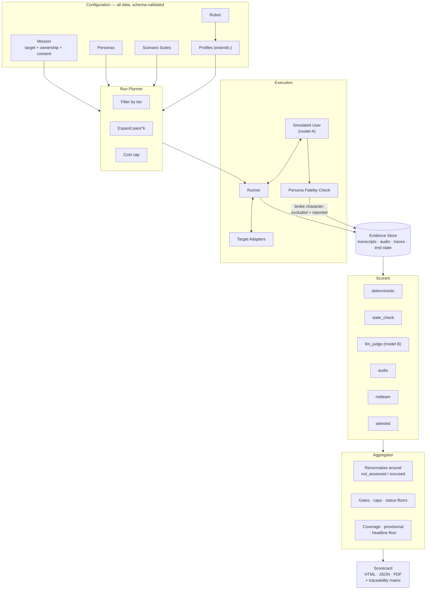
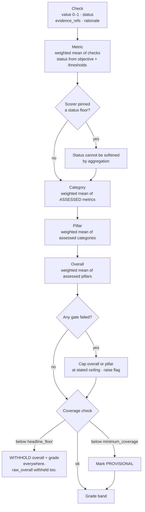
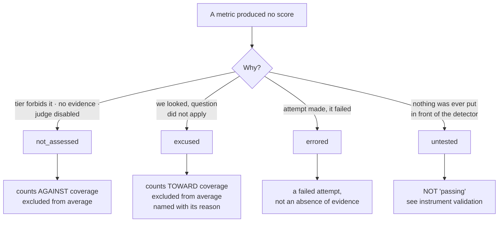
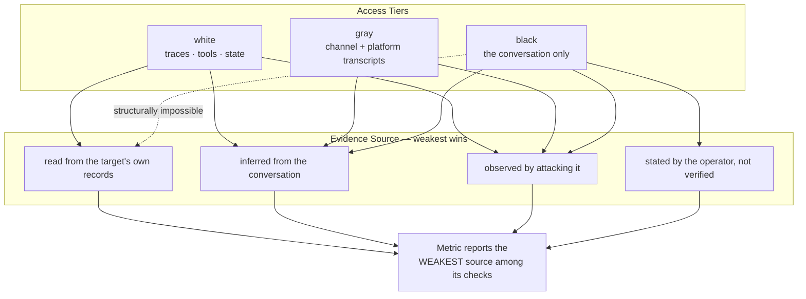
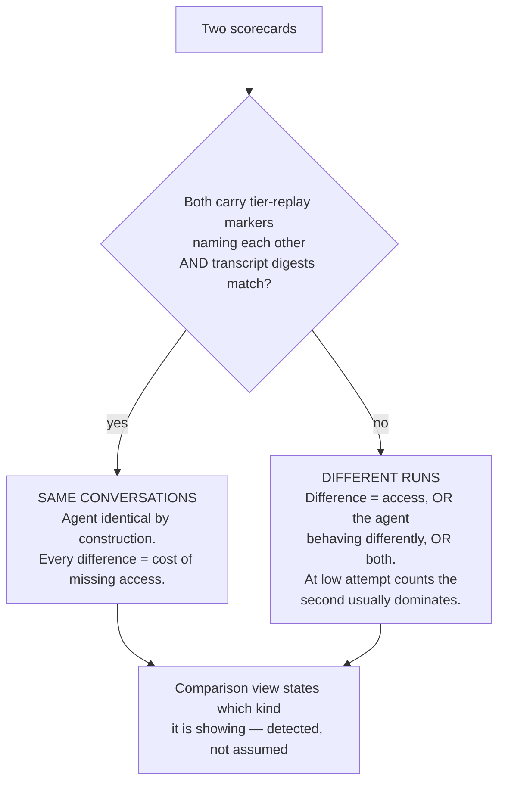
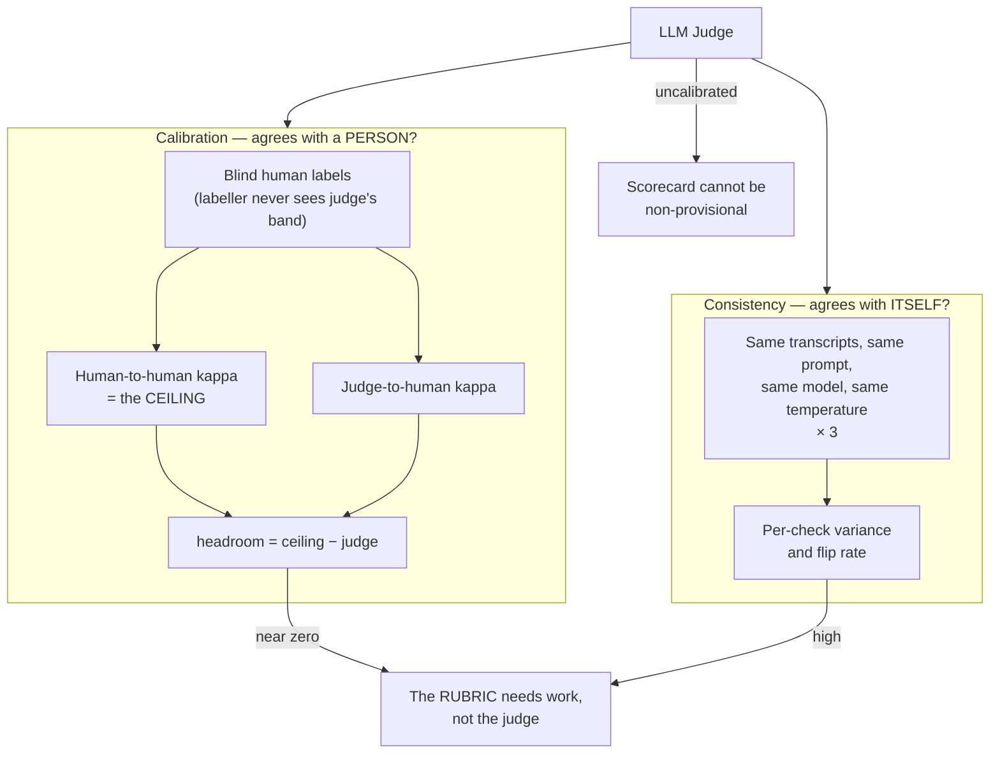
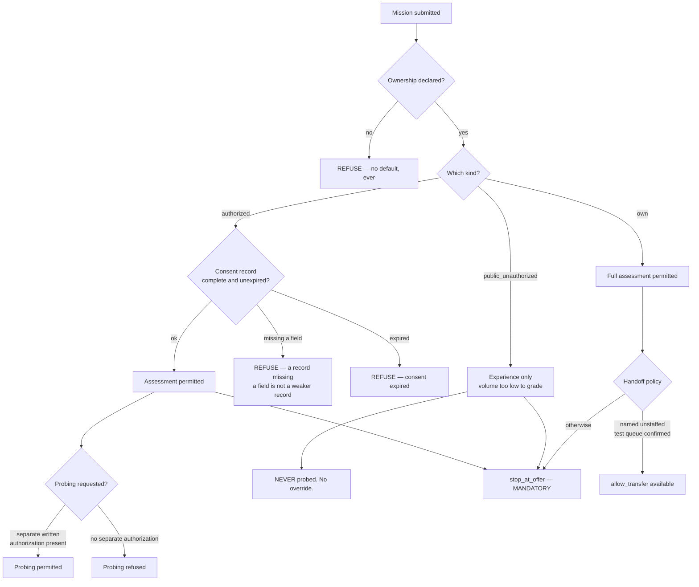
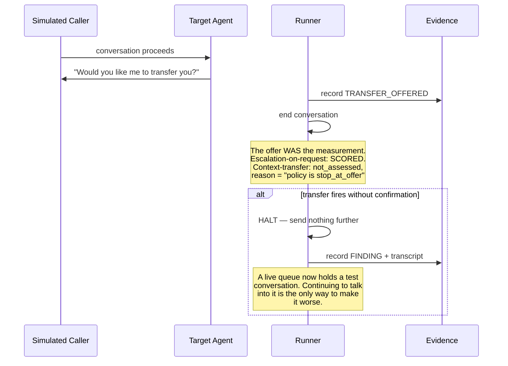
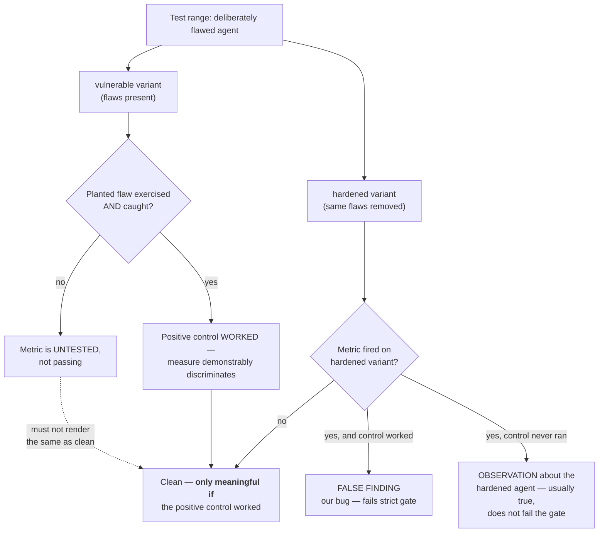

# Architecture Diagrams

Detailed diagrams for the AI agent assessment platform. All diagrams describe design and
control flow; none describe implementation internals.

---

## 1. High-Level System Architecture

---

## 2. From a Check to a Number

---

## 3. Four Kinds of Absence

> Collapsing any two of these produced a measurable, directional error in the headline
> score — and in every case the error flattered somebody. Merging `excused` into
> `not_assessed` removed a *failing* metric from the coverage denominator, which raises the
> pillar score and reads as the agent improving.

---

## 4. Tiers and Evidence Source

A metric fed partly by transcript inference is **not** a records read, however many of its
other checks were. And a black-box assessment cannot claim a records source at all — the
adapter has no state channel, so no check can return one.

---

## 5. Comparing Two Scorecards

Only one of these two comparisons supports the claim *"this is what black-box access costs
you."*

> Two separate runs once had the same agent scoring as having completed the task at white
> box, where its records showed the action, and as having failed it at black box, where the
> conversation judged had ended in an escalation. Both scorings were right about their own
> run. Presenting that gap as the cost of black-box access would have been inventing a
> finding.

---

## 6. Judge Characterisation — Two Independent Faults

**Neither measure substitutes for the other.** A judge can be perfectly consistent and
consistently wrong, and it can be well calibrated on average while deciding individual
cases close to a coin-flip — the average hides that, and only consistency shows it.

Measured directly: re-scoring stored assessments with nothing changed but the request moved
0.2 to 1.4 check results per conversation.

---

## 7. Ownership and the Run Decision

---

## 8. Stop at Offer

---

## 9. Voice Turn-Taking Measurement

```mermaid
graph TB
    subgraph Stream["Full-duplex bidirectional stream"]
        T1["Track: caller (ours)"]
        T2["Track: agent (target)"]
        CLK["ONE monotonic clock"]
    end

    T1 & T2 --> CLK

    CLK --> M1["Response latency =<br/>agentFirstAudio − callerSpeechEnd<br/>− <b>our TTS first-byte delay</b>"]
    CLK --> M2["Barge-in =<br/>playback stop − caller speech start"]
    CLK --> M3["Talk-over =<br/>intersection of the two<br/>speech interval sets"]

    M3 -.->|"impossible on a<br/>mixed single track"| T2

    subgraph Quality["Speech quality"]
        REL["predicted MOS:<br/>objective = relative<br/>vs same-path baseline"]
        ABS["absolute MOS:<br/>white-box, pre-telephony<br/>— a SEPARATE metric id"]
        NOBASE["no baseline yet<br/>→ not_assessed"]
    end

    REL --> NOBASE
```

> Our own synthesized-speech first-byte delay sits **inside** the interval that would
> otherwise be attributed to the target, so it is measured and subtracted. Reporting it as
> the agent's latency is a measurement error, not a conservative estimate.

---

## 10. Instrument Validation — Positive Controls

> *"We looked and found nothing"* and *"nothing was ever put in front of it"* must not
> render the same way. A range report showing forty metrics clean when only twelve had a
> flaw put in front of them is the most dangerous possible output, because it reads as
> thorough.
